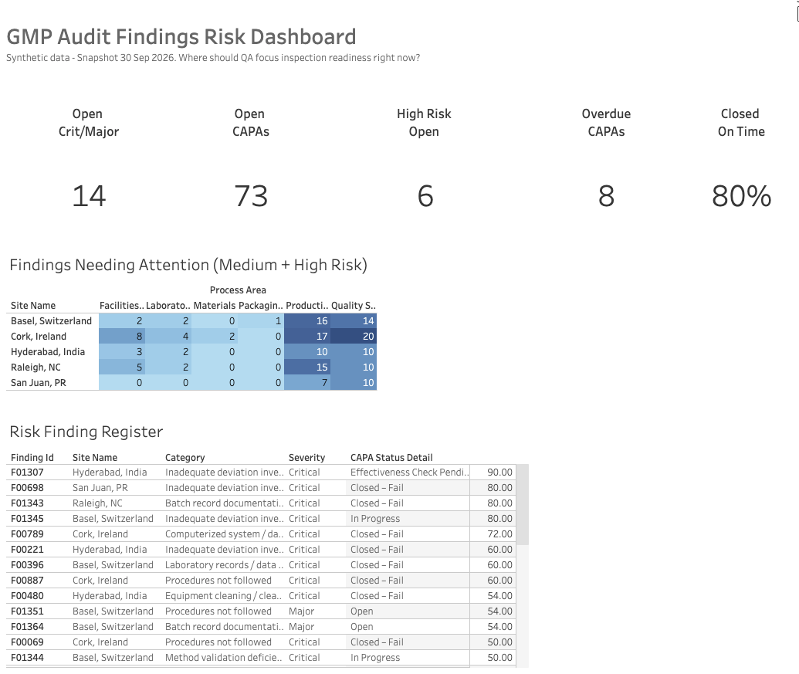
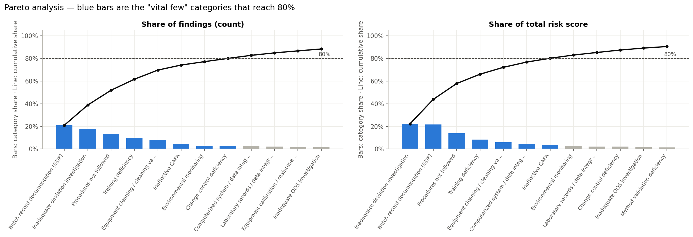
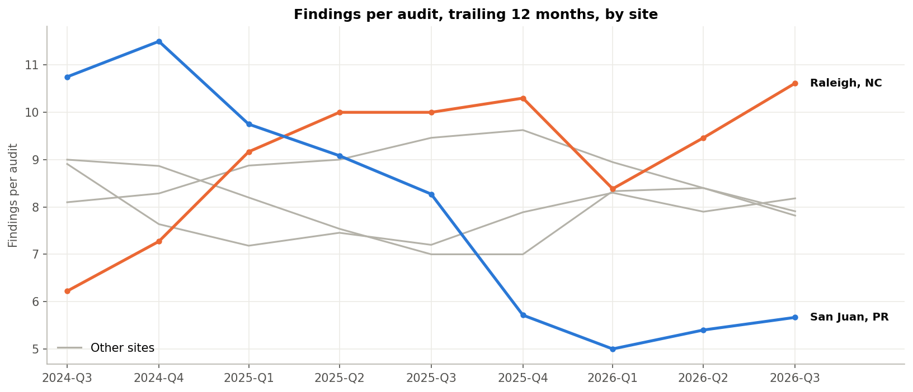
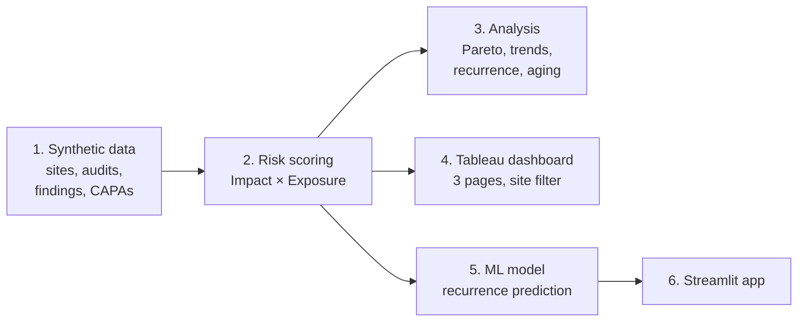
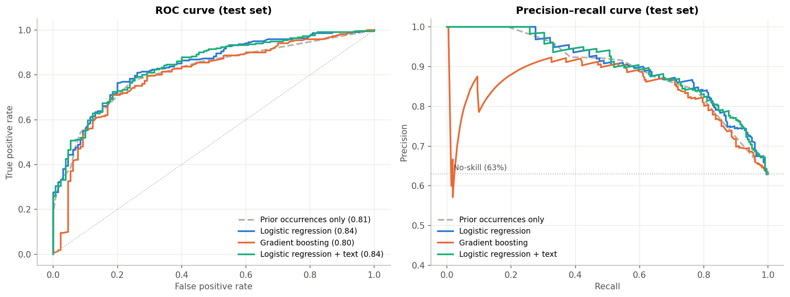

# GMP Audit Findings Risk Dashboard

**A risk-scoring dashboard and ML model that help pharmaceutical QA leadership decide where to focus inspection-readiness work.**

[**▶ Live dashboard (Tableau Public)**](https://public.tableau.com/app/profile/carlos.lantigua4534/viz/GMPAuditFindingsRiskDashboard/1_Overview) · [**▶ Live recurrence predictor (Streamlit)**](STREAMLIT_APP_URL) · [Data dictionary](docs/data_dictionary.md) · [Design decisions](docs/design_decisions.md)

> **All data is synthetic.** It describes *Meridian Pharma*, a fictional company with 5 manufacturing sites, generated with deliberately planted patterns (documented below). No real company data was used.



---

## The problem

GMP audits (internal, corporate, and regulatory) produce hundreds of findings a year. Each one gets a CAPA (corrective and preventive action), but not all findings carry the same risk. A QA director preparing for an FDA or EMA inspection needs to answer:

- **Where is our risk concentrated right now?** Which sites, process areas, and findings?
- **Are our CAPAs working,** or do the same problems keep coming back?
- **Which new findings need a deeper root-cause investigation** instead of a quick fix?

This project answers those questions with a transparent risk score, trend and Pareto analysis, an interactive dashboard, and a machine-learning model.

## Key insights

From 1,365 findings across 163 audits (Oct 2023 – Sep 2026, snapshot 30 Sep 2026):

1. **A few problems drive most findings.** The top 5 of 24 categories make up 70% of findings, led by batch record documentation (GDP). **Ranked by risk instead of count, inadequate deviation investigations move to #1**: counting alone would point leadership at the wrong problem.
2. **Raleigh is getting worse.** Findings per audit rose from 6.2 to 10.6 (trailing 12 months).
3. **San Juan is improving.** Findings per audit fell from 10.8 to 5.7 after a remediation program.
4. **Cork needs the most attention.** It is the worst site on 6 of 8 measures: data integrity is 11% of its findings (3% elsewhere), CAPAs take a median 70 days to close (52 elsewhere), and 27% fail their effectiveness check (12% elsewhere).
5. **A failed effectiveness check predicts a repeat.** After a failed check, the same problem returned within 12 months 80% of the time, vs 61% after a pass.
6. **On-time CAPA closure is steady at about 80%,** but Cork lags at 63%.
7. **73 CAPAs are open, 7 for more than 90 days; 6 open findings are High risk** (4 at Basel).

| Pareto: count vs risk | Findings per audit by site |
|---|---|
|  |  |

## Approach



### 1. Synthetic data ([`01_generate_data`](notebooks/01_generate_data.ipynb))
Four linked tables (sites → audits → findings → CAPAs) following a documented [data dictionary](docs/data_dictionary.md). Categories map to the FDA six-system inspection model and 21 CFR 211 citations; severity follows EU GMP / PIC/S classification. Patterns were planted on purpose and **verified in code**: Pareto skew, a problem site, item-level recurrence linked to failed CAPAs, severity mix by audit type, CAPA timing, and site trends. Fifteen automated data-quality checks enforce the business rules before anything is saved.

### 2. Risk scoring ([`02_risk_scoring`](notebooks/02_risk_scoring.ipynb))
Following ICH Q9(R1), where risk combines severity and probability:

> **Risk score (0–100) = Impact (1–10) × Exposure (1–10)**

| | Built from |
|---|---|
| **Impact** | Severity (Critical 10, Major 5, Minor 2) × process-area criticality, with a boost for production and equipment findings at sterile sites |
| **Exposure** | CAPA status (Open 6 → Closed & effective 1), +3 if overdue, +1 per prior occurrence (max +3) |

Tiers (High ≥ 40, Medium 15–39, Low < 15) were set from **anchor scenarios**, plain statements a QA director would agree with (e.g., *every open Critical is High; no Minor is ever High*), which the notebook tests automatically. A **sensitivity test** shows the top 20 active findings stay stable (16–20 of 20) when any single weight changes. Result: 33 High, 127 Medium, 1,205 Low.

### 3. Analysis ([`03_analysis`](notebooks/03_analysis.ipynb))
Pareto by count and by risk, findings-per-audit trends (normalized for audit frequency), on-time CAPA closure by quarter due (so late, still-open CAPAs count as late), recurrence, site profiles, and CAPA aging. The key insights above are generated from the data by code, so the text always matches the numbers.

### 4. Dashboard ([Tableau Public](https://public.tableau.com/app/profile/carlos.lantigua4534/viz/GMPAuditFindingsRiskDashboard/1_Overview))
Three pages: **Overview** (KPIs, site × process-area heatmap, High-risk register), **Pareto & Trends**, and **CAPA & Recurrence**. A site filter works across all pages, and clicking a heatmap cell filters the register.

### 5. Machine learning ([`04_ml_model`](notebooks/04_ml_model.ipynb))
**Question:** when a finding is first raised, will the same problem be cited again on the same item within 12 months?

- **No data leakage:** only information available when a finding is logged (no CAPA status, close dates, or risk score).
- **Time-based validation:** trained on Oct 2023 – Dec 2024, tested on Jan – Sep 2025.

| Model | ROC-AUC | PR-AUC |
|---|---|---|
| Always predict "recurs" | 0.50 | 0.63 |
| Baseline: rank by prior occurrences | 0.815 | 0.87 |
| **Logistic regression (final)** | **0.837** | **0.90** |
| Gradient boosting | 0.80 | 0.84 |
| Logistic regression + TF-IDF text | 0.838 | 0.90 |

Flagging the top half of new findings catches **69%** of problems that recur, with **87%** precision (87% of flagged findings recur vs 39% of unflagged).

**Honest read:** the model beats the simple baseline by only 0.02. Most of the signal is "this has happened here before"; the model adds category and site context. Text features added nothing because the synthetic descriptions are template-based. A second target, predicting overdue CAPAs, reached only ROC-AUC 0.65, because the synthetic data plants lateness mainly by site. Both results are reported rather than hidden.



### 6. Recurrence predictor app ([Streamlit](STREAMLIT_APP_URL))
Enter a new finding and get its chance of recurrence, a flag for deeper root-cause analysis, its initial risk score, and a "what if" chart showing how repeat history changes the prediction.

## Repository structure

```
├── notebooks/
│   ├── 01_generate_data.ipynb   # synthetic data + quality checks
│   ├── 02_risk_scoring.ipynb    # Impact × Exposure scoring, sensitivity test
│   ├── 03_analysis.ipynb        # Pareto, trends, recurrence, insights
│   └── 04_ml_model.ipynb        # recurrence model, baselines, evaluation
├── app/
│   ├── app.py                   # Streamlit app
│   └── requirements.txt
├── models/                      # trained model, metadata, scoring weights
├── figures/                     # charts used in this README
└── docs/
    ├── data_dictionary.md       # tables, values, business rules
    ├── design_decisions.md      # decision log (D1–D9)
    └── domain_background.md     # GMP, 21 CFR 211, ICH Q9(R1)
```

## Reproduce it

Everything runs free in Google Colab. Run the notebooks in order; each saves its outputs to Google Drive (`MyDrive/gmp-audit-risk-dashboard/`) for the next one.

| Step | Notebook | Open |
|---|---|---|
| 1 | Generate data | [](https://colab.research.google.com/github/cjlantigua-hue/gmp-audit-risk-dashboard/blob/main/notebooks/01_generate_data.ipynb) |
| 2 | Risk scoring | [](https://colab.research.google.com/github/cjlantigua-hue/gmp-audit-risk-dashboard/blob/main/notebooks/02_risk_scoring.ipynb) |
| 3 | Analysis | [](https://colab.research.google.com/github/cjlantigua-hue/gmp-audit-risk-dashboard/blob/main/notebooks/03_analysis.ipynb) |
| 4 | ML model | [](https://colab.research.google.com/github/cjlantigua-hue/gmp-audit-risk-dashboard/blob/main/notebooks/04_ml_model.ipynb) |

A fixed random seed (42) makes every run produce identical data and results. To run the app locally: `pip install -r app/requirements.txt`, then `streamlit run app/app.py`.

**Tools:** Python (pandas, NumPy, scikit-learn, Matplotlib, Faker), Google Colab, Tableau Public, Streamlit.

## Limitations and next steps

- **Synthetic data.** The analysis and model can only rediscover patterns that were designed in. The value shown is a documented, tested, leakage-free pipeline ready to run on real data.
- **Simplifications:** one CAPA per finding (real systems are often many-to-many) and supplier audits excluded. See [design decisions](docs/design_decisions.md).
- **Risk weights are design assumptions** aligned with ICH Q9(R1) principles, not a regulatory standard; in practice they would be calibrated with QA stakeholders.
- **Next steps:** retrain on real, free-text audit findings (where NLP features should add real signal); add CAPA owner and workload features to the overdue model; schedule automatic data refresh.

---

**Author:** Carlos Lantigua · [LinkedIn](LINKEDIN_URL) · [Tableau Public](https://public.tableau.com/app/profile/carlos.lantigua4534)
